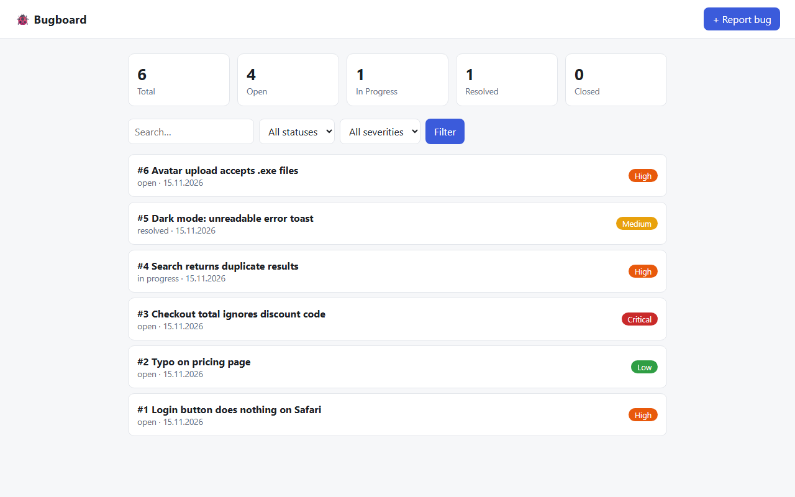
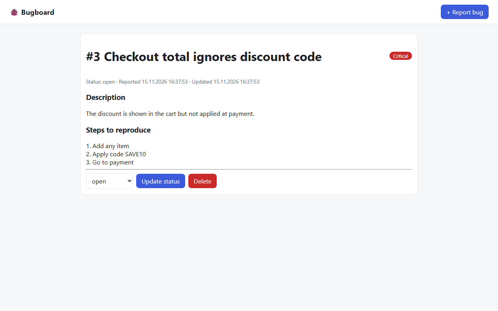
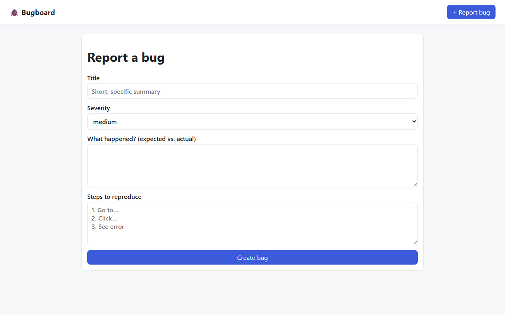

# 🐞 Bugboard

A small, full-stack bug tracker: report bugs with steps to reproduce, filter them by status and severity, and move them from **open** to **closed**.

I built it to practise the whole path a bug takes, from the form a tester fills in to the row in the database, and to keep the API honest with tests at several levels.




<table>
  <tr>
    <td></td>
    <td></td>
  </tr>
  <tr>
    <td align="center"><sub>Bug details</sub></td>
    <td align="center"><sub>Reporting a bug</sub></td>
  </tr>
</table>

## Stack

| Layer | Tech |
|---|---|
| Frontend | Next.js 15 (App Router, Server Actions), React 19, TypeScript |
| Backend | Node.js, Express, TypeScript, Zod validation |
| Database | PostgreSQL 16 (with an in-memory fallback for quick local runs) |
| Tests | Jest + Supertest (unit/HTTP), Node test runner (web client), Postman collection run with Newman (contract) |
| Ops | Docker, Docker Compose, GitHub Actions |

## Architecture

```
web (Next.js) ──HTTP──▶ api (Express) ──▶ BugRepository (interface)
                                             ├── PgBugRepository   → PostgreSQL
                                             └── InMemoryBugRepository → tests / demo
```

The HTTP layer only depends on the `BugRepository` interface, so the same routes run against PostgreSQL in production and against memory in tests.

## Run it

**With Docker** (API + web + PostgreSQL):

```bash
docker compose up --build
# web → http://localhost:3000   api → http://localhost:4000
```

**Without Docker** (API uses in-memory demo data):

```bash
cd api && npm install && npm run dev      # http://localhost:4000
cd web && npm install && npm run dev      # http://localhost:3000
```

Set `DATABASE_URL` for the API to use PostgreSQL (`api/db/schema.sql` creates the table).

## API

| Method | Path | Description |
|---|---|---|
| GET | `/health` | Liveness check |
| GET | `/bugs?status=&severity=&q=` | List bugs, newest first, with optional filters |
| GET | `/bugs/:id` | One bug |
| POST | `/bugs` | Create (`title` required; `severity` defaults to `medium`) |
| PATCH | `/bugs/:id` | Update any field, e.g. `{ "status": "resolved" }` |
| DELETE | `/bugs/:id` | Delete |
| GET | `/stats` | Counts by status and severity |

Invalid input returns `400` with the validation details; unknown ids return `404`; unexpected errors return a generic `500` without leaking internals.

## Tests

```bash
cd api && npm test                                   # 22 Jest tests
cd web && npm test                                   # 7 tests for the web client (node:test, no extra deps)
npx newman run postman/bugboard.postman_collection.json   # needs the API running
```

What is covered:

- every route, including the unhappy paths (bad JSON, unknown fields, empty patches, too-long titles, non-numeric ids)
- the PostgreSQL adapter with a mocked `pg` pool, checking that every query is parameterized (no SQL injection through filters)
- the web client's API helper with a mocked `fetch`: request shape, 204 responses, validation details on a 400, a non-JSON error body
- CI runs the Newman collection against a **real PostgreSQL** service container

## License

MIT
